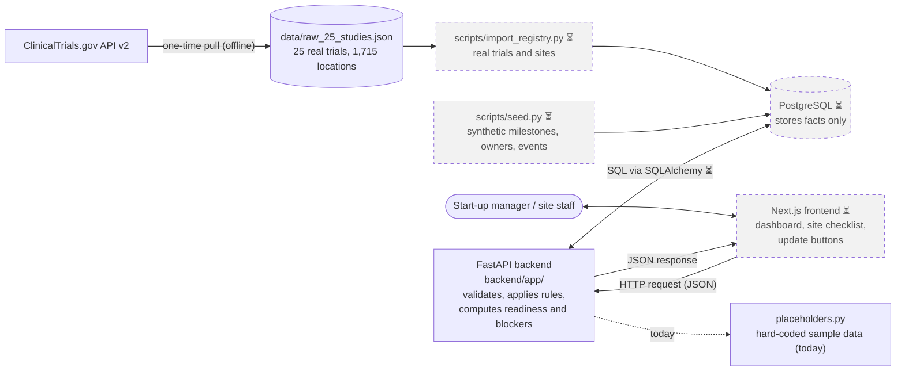
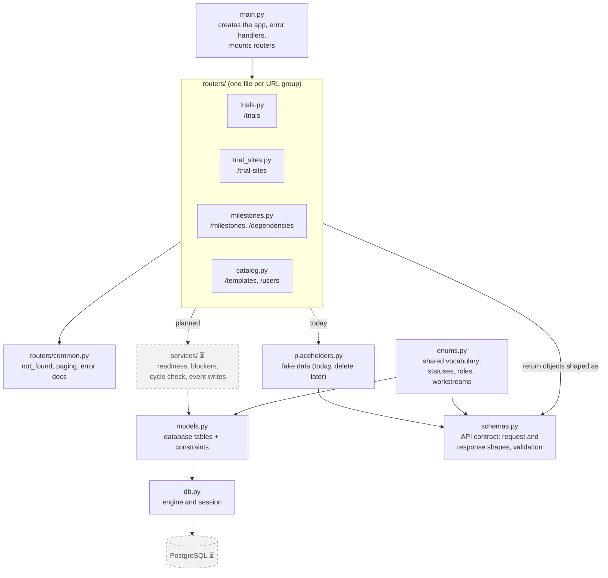
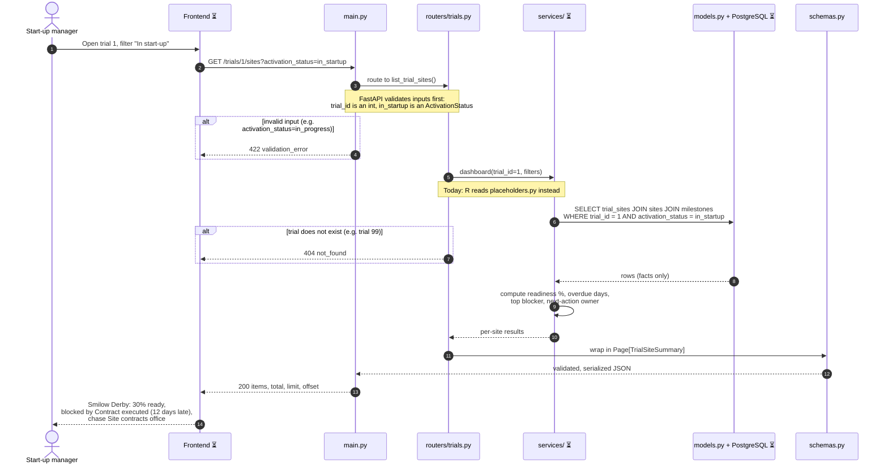

# TrialFlow System Overview

How the frontend, backend, and database fit together; how the backend files connect; and one request traced end to end. Diagrams are Mermaid and render on GitHub and in VS Code's Markdown preview.

**Legend:** ⏳ = planned, not built yet. Dashed grey boxes are planned. Today the backend serves hard-coded data from `placeholders.py` instead of a database.

## 1. System overview



- **Frontend:** shows data and sends user changes. No business logic.
- **Backend:** validates every request, enforces the rules, and computes readiness, delays, blockers, and next-action owners on each request.
- **Database:** stores facts only (statuses, dates, owners, history), never computed values.
- **Scripts:** load the database before the app runs. The app never calls ClinicalTrials.gov while serving a request.

## 2. Backend file map



| File | Main job |
|---|---|
| `main.py` | Starts the app, mounts the routers, and converts every error to `{detail, code}` |
| `routers/*.py` | Define the URLs; take a request, get data, return a schema object |
| `routers/common.py` | Shared helpers: `not_found()`, paging limits, error docs |
| `schemas.py` | What goes over the wire: validates input, shapes output, generates `/docs` |
| `models.py` | What is stored: tables and constraints (e.g. one row per trial and site pair) |
| `db.py` | Database connection setup; turns on foreign keys for SQLite in tests |
| `enums.py` | Allowed values, shared by models and schemas so they never disagree |
| `placeholders.py` | Temporary fake data in schema shape; replaced by services and the database |
| `services/` ⏳ | Business logic: readiness, blockers, cycle detection, event writes |

Dependency direction: **routers → services → models → database**, with **schemas** shaping what goes back out.

## 3. Sample data flow: "Show activation status for trial 1"

A start-up manager opens trial 1 and filters to sites still in start-up.



**Only the totals?** `GET /trials/1` follows the same path and returns a `TrialDetail` whose `activation_counts` (e.g. 12 in start-up, 47 activated) are computed by counting trial sites by status.

**The write path** goes the other way. Site staff mark a milestone complete, so the frontend sends `PATCH /milestones/{id}` to `routers/milestones.py`. The planned service then:
- updates the milestone row;
- writes a `milestone_events` row in the same transaction;
- sets the trial site to `activated` if the milestone is GREEN_LIGHT.

The next dashboard request then shows the new readiness.

**Try it today** (steps 2–12 run on placeholder data):
```bash
cd backend && uvicorn app.main:app --reload
curl "localhost:8000/trials/1/sites?activation_status=in_startup"
```

Keep this file up to date when the structure changes (e.g. when `services/`, the database, or the frontend is built).
