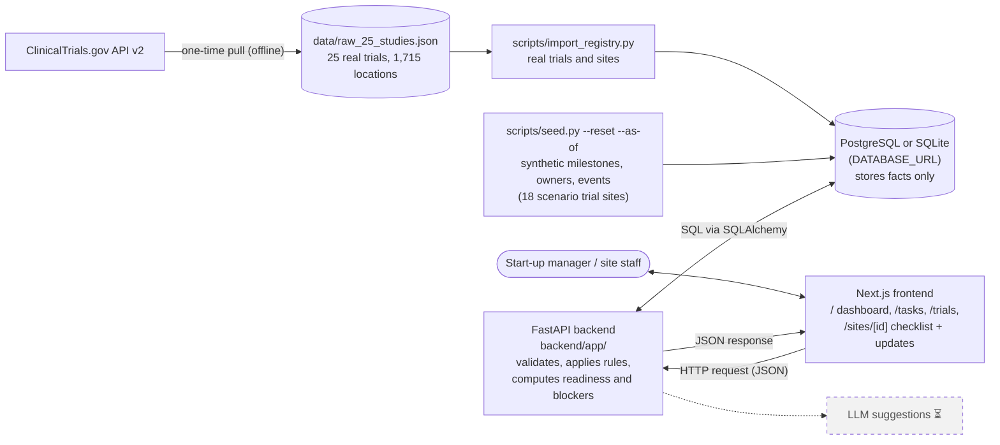
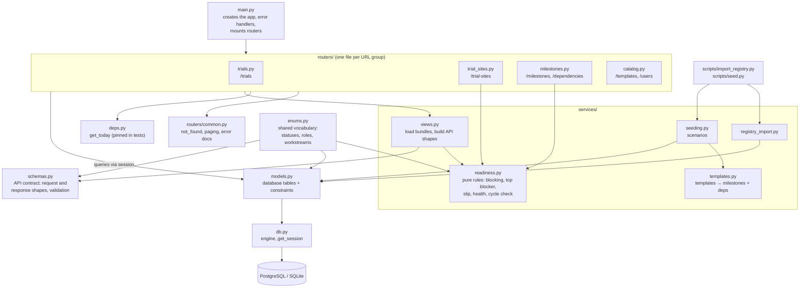
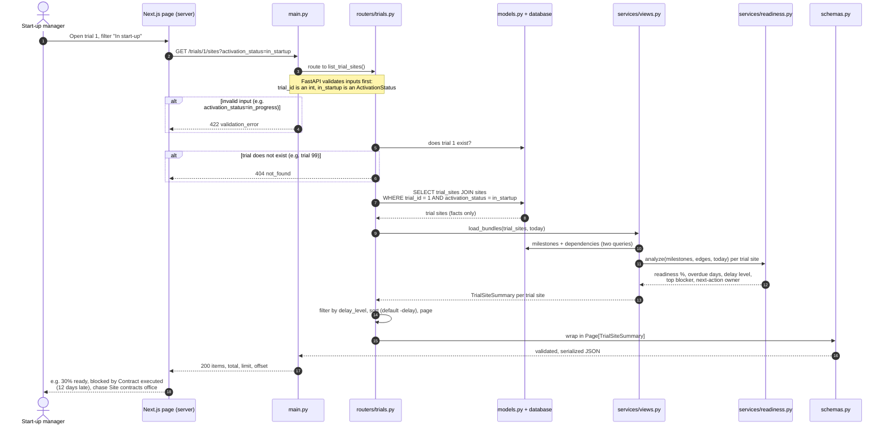

# TrialFlow System Overview

How the frontend, backend, and database fit together; how the backend files connect; and one request traced end to end. Diagrams are Mermaid and render on GitHub and in VS Code's Markdown preview.

**Legend:** ⏳ = planned, not built yet. Dashed grey boxes are planned. `DATABASE_URL` picks the database: PostgreSQL by default, SQLite for local runs and tests (in-memory).

## 1. System overview



- **Frontend:** shows data and sends user changes. Pages fetch on the server (`API_URL`); milestone updates go from the browser (`NEXT_PUBLIC_API_URL`). `src/lib/insights.ts` derives My tasks and trial summaries from existing endpoints; it adds no business rules.
- **Backend:** validates every request, enforces the rules, and computes readiness, delays, blockers, and next-action owners on each request.
- **Database:** stores facts only (statuses, dates, owners, history), never computed values.
- **Scripts:** load the database before the app runs. The app never calls ClinicalTrials.gov while serving a request.

## 2. Backend file map



| File | Main job |
|---|---|
| `main.py` | Starts the app, mounts the routers, and converts every error to `{detail, code}` |
| `routers/*.py` | Define the URLs; query the database, call services, return a schema object |
| `routers/common.py` | Shared helpers: `not_found()`, paging limits, error docs |
| `deps.py` | `get_today()`: the date computed values are measured against; tests override it |
| `services/readiness.py` | Pure functions (no database): `analyze()` for readiness, blocking, top blocker, slip, health; `find_path()` for cycle checks. See `docs/domain-rules.md` |
| `services/views.py` | `load_bundles()` loads milestones and dependencies for many trial sites in two queries, runs `analyze()`, and builds response schemas |
| `services/templates.py` | Copies milestone templates and template dependencies into a new trial site |
| `services/registry_import.py` | Parses the registry JSON into trials, sites, and trial sites (dedup keys, partial dates) |
| `services/seeding.py` | Synthetic owners, milestones, and events for the scenario trial sites |
| `schemas.py` | What goes over the wire: validates input, shapes output, generates `/docs` |
| `models.py` | What is stored: tables and constraints (e.g. one row per trial and site pair) |
| `db.py` | Engine and `get_session`; turns on foreign keys for SQLite |
| `enums.py` | Allowed values, shared by models, schemas, and services so they never disagree |

Dependency direction: **routers → services → models → database**, with **schemas** shaping what goes back out. `readiness.py` never touches the database, so its rules are tested with plain inputs.

## 3. Sample data flow: "Show activation status for trial 1"

A start-up manager opens trial 1 and filters to sites still in start-up.



**Only the totals?** `GET /trials/1` follows the same path and returns a `TrialDetail` whose `activation_counts` (e.g. 12 in start-up, 47 activated) are computed by counting trial sites by status.

**The write path** goes the other way. Site staff mark a milestone complete in the browser, which sends `PATCH /milestones/{id}` to `routers/milestones.py`. In one transaction, it:
- rejects the change with 409 `unsatisfied_dependencies` if a predecessor is still open;
- updates the milestone row and writes one `milestone_events` row per changed field (status, owner, due date);
- sets the trial site to `activated` when GREEN_LIGHT is completed, and back to `in_startup` if it is reopened;
- returns the updated milestone, its events, and the trial site's activation status.

Adding a dependency (`POST /trial-sites/{id}/dependencies`) runs `readiness.find_path()` first and returns 409 `dependency_cycle` with the cycle path if the new edge would close a loop.

The next dashboard request then shows the new readiness.

**Try it** (local SQLite, all from the repo root so every step opens the same `trialflow.db`):
```bash
export DATABASE_URL=sqlite:///trialflow.db
python scripts/import_registry.py && python scripts/seed.py --reset
uvicorn app.main:app --app-dir backend --reload
curl "localhost:8000/trials/1/sites?activation_status=in_startup"
cd frontend && npm install && npm run dev   # second terminal; http://localhost:3000
```

Keep this file up to date when the structure changes (e.g. when the LLM layer or new services are added).
