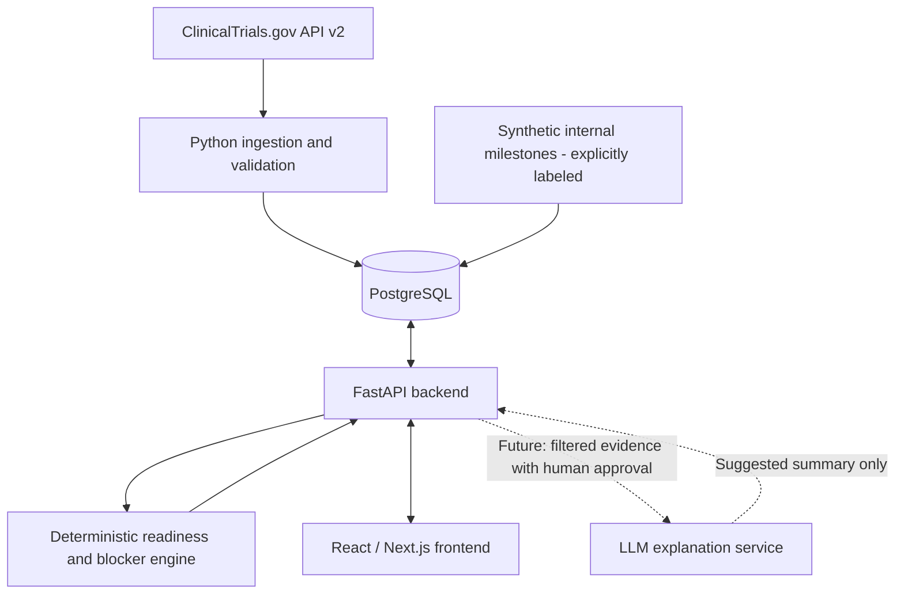

# TrialFlow: Architecture and Technical Stack
**Stanford CS 146S, Autumn 2026 | Samhita's technical specification sections**

## Research: ClinicalTrials.gov and AACT
TrialFlow will initially ingest real study and facility records using the public ClinicalTrials.gov API v2 (`GET https://clinicaltrials.gov/api/v2/studies`). It exposes study identifiers, titles, overall recruitment statuses, start/completion dates, and locations where provided. Records have nested `protocolSection` modules. `identificationModule.nctId` identifies each study; `statusModule.overallStatus` and the `statusModule` date structs describe reported study progress; `contactsLocationsModule.locations[]` lists reported facilities, geography, and location-level status. Public registry records are self-reported and not equivalent to internal sponsor/CRO operational systems.

AACT, maintained by the Clinical Trials Transformation Initiative, mirrors ClinicalTrials.gov into more than 40 relational tables and supports SQL joins by `nct_id`. AACT is useful for future aggregate research; the MVP will use API v2 directly, avoiding the account and database snapshot workflow.

### Public-data availability and limitations
| Data element | Public availability | MVP treatment |
|---|---|---|
| NCT ID, study title, overall recruitment status | Yes | Real source records |
| Reported facility, city, state, country | When supplied | Real site records; nullable fields |
| Site-level recruitment status | When supplied | Display as *reported recruitment status*, not activation |
| Study start/completion and last-update dates | When supplied | Context for trial timeline; not site activation dates |
| IRB approval per site | Not a standard structured per-site field | Synthetic, clearly labeled |
| Contract execution, negotiated budget | Not in registry structured site records | Synthetic, clearly labeled |
| Training, pharmacy setup, investigational product shipment | Not in registry structured site records | Synthetic, clearly labeled |
| Site initiation visit, site activation timestamp | Not provided as reliable structured per-site operations data | Synthetic, clearly labeled |

**Interpretation:** A registry location marked RECRUITING does not establish that all tracked internal activation milestones are complete. TrialFlow will never infer IRB approval or contract sign-off from the reported recruitment label.

### Sampling method
Run `python extract_trials.py` with the `requests` package installed. The script queries breast-cancer studies with RECRUITING or NOT_YET_RECRUITING status, sorts by last registry update, selects the first 25 distinct NCT records with at least one reported location, and exports `trials.csv`, `sites.csv`, raw JSON, and retrieval metadata. The selection is convenience-based, not a representative clinical-trials sample. One site row corresponds to one reported registry location. Missing values remain blank. The dataset must be generated against the live API and should not be described as extracted until execution succeeds. Output also includes the retrieval timestamp for reproducibility.

## Architecture

The ingestion job requests and validates public study and location data, maps NCT IDs and reported facilities to local IDs, and upserts records into PostgreSQL. A separate seeding script creates explicitly synthetic operational milestones such as IRB approval, contract signature, budget finalization, training, pharmacy readiness, and drug shipment. Foreign keys associate milestones with a site. API responses include a provenance marker identifying public-registry or synthetic data.

The backend exposes trial lists, sites and milestone status, and a readiness summary. A deterministic dependency engine checks whether required milestones are complete and identifies missing prerequisites. For example, a site can be blocked by an incomplete IRB approval or unsigned contract. The frontend shows the trial overview, site-by-site milestone checklist, priority blockers, and next responsible action. In the MVP, synthetic milestone changes are local application data and never written to ClinicalTrials.gov.

Future LLM integration attaches to the backend after the readiness engine. It receives filtered, structured site status and evidence with no unnecessary personal data, and generates *suggested explanations* rather than authoritative status changes. Missing evidence must remain unknown. The final readiness result is computed from recorded milestone states, not inferred by the model.

### Key database entities
- `trials`: `id`, `nct_id` (unique), `title`, `overall_status`, `start_date`, `completion_date`, `last_registry_sync_at`.
- `sites`: `id`, `trial_id`, `facility`, `city`, `state`, `country`, `reported_recruitment_status`, `source_type`.
- `milestones`: `id`, `site_id`, `type`, `status` (`not_started`/`in_progress`/`complete`/`blocked`), `due_date`, `completed_at`, `owner`, `source_type`.
- `milestone_dependencies`: `milestone_id`, `prerequisite_milestone_id`.
- `blockers`: `id`, `site_id`, `milestone_id`, `reason`, `status`, `detected_at`.

### Readiness definition
For the prototype, the readiness percentage is `number of required milestones marked complete / number of required milestones` times 100. A site is *ready* only when all required milestones are complete and no unresolved blocking dependency remains. This is a project-defined operational score, not a value obtained from ClinicalTrials.gov. Due dates and owners are stored independently of reported study dates.

## Technical Stack
| Component | Technology | Why |
|---|---|---|
| Source | ClinicalTrials.gov API v2 | No AACT database provisioning needed for initial import |
| Ingestion | Python, `requests` | Simple repeatable ingestion and normalization |
| API | Python, FastAPI | Typed REST endpoints and straightforward validation |
| Data model | Pydantic and SQLAlchemy | Typed inputs and relational persistence |
| Database | PostgreSQL | Supports trial-site-milestone relationships and dependency queries |
| Frontend | Next.js, React, TypeScript | Interactive dashboard and site status views |
| Automated tests | pytest, Playwright | Verify readiness rules and end-to-end workflows |
| Future LLM | Provider API behind FastAPI | Generate grounded explanations only after MVP logic works |

**Scope boundaries:** The MVP uses 25 real trials, their reported locations, and synthetic activation records. It does not access confidential sponsor systems, represent recruitment status as readiness, make regulatory decisions, or claim production integrations that are not implemented. API imports should be refreshable and retain source timestamps so changing public records remain traceable.

### References
1. https://clinicaltrials.gov/data-api/api
2. https://clinicaltrials.gov/api/v2/studies
3. https://aact.ctti-clinicaltrials.org/landing
4. https://aact.ctti-clinicaltrials.org/documentation
